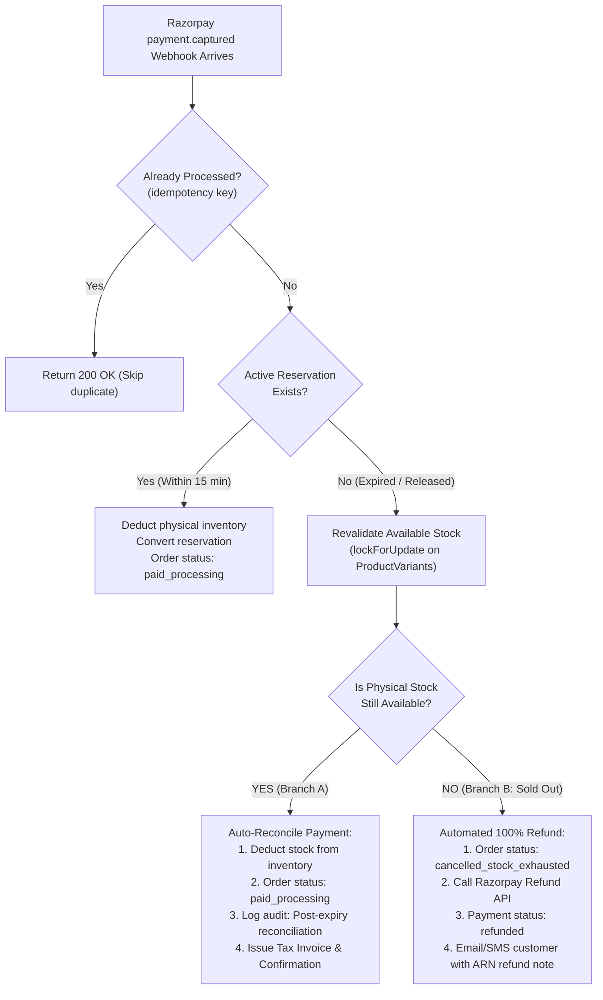

# PEACHY PLATE — Food Products E-Commerce Architecture Specification

**Version:** 1.2.0-AUDITED (Laravel 13, PHP 8.3+, MariaDB 11.4 LTS, Razorpay Recovery & FSSAI Compliant)  
**Domain:** Packaged Food Products E-Commerce (Snacks, Beverages, Confectionery, Healthy Foods, Gourmet Pantry)  
**Target Market:** India (DTC, Pan-India Dispatch)  
**Target Platforms:** Web (Desktop & Mobile-First Responsive)  
**Primary Stack:** Next.js (App Router, TypeScript, Tailwind CSS, Framer Motion, GSAP) + Laravel 13 (REST APIs, Sanctum, MariaDB 11.4 LTS, Eloquent ORM)

---

## 1. Executive Summary & Business Context

**PEACHY PLATE** is an artisanal and modern packaged food products e-commerce brand platform. It is strictly a **packaged food retail brand**, not a restaurant, cafe, or quick-service food delivery application.

> [!IMPORTANT]
> **Strict Business Boundary:** Peachy Plate does not support table reservations, dine-in ordering, hot kitchen order tickets (KOT), or restaurant menus. It sells sealed, packaged food products governed by the Food Safety and Standards Authority of India (FSSAI) and the Legal Metrology (Packaged Commodities) Rules:
> - Artisanal Popped & Roasted Snacks
> - Cold & Sparkling Botanical Elixirs, Craft Sodas
> - Single-Origin Dark Chocolates, Confections, Craft Cookies
> - Clean Organic Pantry Staples, Cold-Pressed Oils, Raw Mountain Honey
> - Premium Dry Fruits, Nuts, and Gourmet Trail Mixes

### The Core Architectural Tenet: Single Engine, Three Visual Concepts
The brand evaluates **three distinct visual expressions** on top of **one shared backend engine**:
1. **Concept A: FLAVOURVERSE** — Bold editorial food universe (editorial typography, magazine-style layouts, high contrast, deep plum `#1F0E1C` and saffron `#FF9F1C`, culinary storytelling).
2. **Concept B: PURE & PANTRY** — Modern organic and wellness (mindful, earthy sage `#4A5844` and terracotta `#C86D51`, raw linen `#F7F4EE`, refined serif typography, ingredient nutrition transparency).
3. **Concept C: SNACK ATTACK** — Maximalist snack culture (hyper-vibrant pop art, electric lime `#70E000` and hot peach `#FF6B6B`, neo-brutalist solid black drop-shadows, sticker badges, bouncy spring physics).

All three concepts share **100% of the backend core**:
- Same MariaDB 11.4 database schema.
- Same inventory allocation and temporary checkout stock reservation engine.
- Same REST API contract.
- Same authentication, cart calculations, coupon engine, and checkout pipeline.
- Same administrative back-office command center.

---

## 2. Upgraded Technology Stack & Runtime Environment

### 2.1 Backend Runtime & Database Stack
- **Framework:** **Laravel 13** (`laravel/framework: ^13.0`)
- **PHP Runtime:** **PHP 8.3+** (minimum PHP 8.3 required by Laravel 13; supports typed class constants, json_validate, dynamic class constant fetch)
- **Database Engine:** **MariaDB 11.4 LTS** (Long Term Support through 2029; replacing legacy 10.4.32)
- **Auth Guard:** Laravel Sanctum 4.0
- **Payment SDK:** Razorpay PHP SDK 2.9+

### 2.2 MariaDB 10.4 to 11.4 LTS Migration & Data Preservation Procedure
To upgrade the database runtime while guaranteeing zero loss of existing databases:
1. **Full Database Dump:**
   ```powershell
   & "C:\xampp\mysql\bin\mysqldump.exe" -u root --all-databases --routines --triggers --events > "C:\xampp\pre_upgrade_all_databases_backup.sql"
   ```
2. **Cold Data Directory Snapshot:**
   ```powershell
   Copy-Item -Path "C:\xampp\mysql\data" -Destination "C:\xampp\mysql\data_backup_mariadb104" -Recurse
   ```
3. **Engine Binary Replacement:** Stop MySQL service in XAMPP. Install/extract MariaDB 11.4 LTS binaries into `C:\xampp\mysql`.
4. **Data Dictionary Upgrade:**
   ```powershell
   & "C:\xampp\mysql\bin\mariadb-upgrade.exe" -u root
   ```
5. **Integrity Verification:** Inspect existing application databases to verify all tables and user permissions are intact.

---

## 3. Indian Food Regulatory Compliance Documentation

### 3.1 Applicable Regulations
The platform's data models, seeders, and storefront product display pages (PDP) are designed in strict conformance with:
1. **Food Safety and Standards (Labelling and Display) Regulations, 2020** (Gazetted Notification No. F. No. 1-94/FSSAI/SP(Labelling)/2020) and subsequent amendments (2021, 2022, 2023).
2. **Food Safety and Standards (Packaging) Regulations, 2018**.
3. **Legal Metrology Act, 2009** and **Legal Metrology (Packaged Commodities) Rules, 2011 (as amended 2022 for E-Commerce entities)**.

### 3.2 Statutory Labelling Provisions Implemented in Peachy Plate:
- **Regulation 5(1) & 5(2) — Nutritional Information:**
  - Mandatory disclosure of: Energy ($kcal$), Protein ($g$), Carbohydrate ($g$), Total Sugars ($g$), Added Sugars ($g$), Total Fat ($g$), Saturated Fat ($g$), Trans Fat ($g$), and Sodium ($mg$).
  - Disclosed both **per 100g / 100ml** and **per specified single serving size**, along with percentage contribution to Recommended Dietary Allowance (% RDA) based on ICMR-NIN 2000 kcal adult diet guidelines.
- **Regulation 5(3) — List of Ingredients:**
  - Full declaration of ingredients in strictly descending order of incoming weight ($m/m$) at the time of manufacture.
- **Regulation 5(4) — Allergen Declarations:**
  - Mandatory separate warning callout for specified food allergens: gluten-containing cereals, peanuts, tree nuts, milk/dairy, soybeans, sulphites $\ge 10\text{ mg/kg}$.
- **Regulation 5(5) — Veg / Non-Veg Logo:**
  - Vegetarian packaged foods display the green circle inside a square border; non-vegetarian items display the brown triangle inside a square border.
- **Regulation 5(7) — Dual Manufacturer & Marketer Attribution:**
  - Distinct fields on every product detail page for both:
    1. **Marketer:** Name, complete registered address, and 14-digit FSSAI license (`Peachy Plate Foods Pvt Ltd`).
    2. **Manufacturer / Packer:** Name, manufacturing unit address, and manufacturing unit 14-digit FSSAI license.
- **Legal Metrology E-Commerce Disclosures:**
  - Net quantity declaration ($g$, $kg$, $ml$, or count), Maximum Retail Price (MRP inclusive of all taxes), country of origin (`India`), and consumer care contact.

> [!NOTE]
> **Test Data Policy:** All FSSAI license numbers, manufacturer addresses, GST rates, and nutritional lab numbers in initial seeders and mock catalogs are explicitly tagged as `[TEST DATA - NON-PRODUCTION]` until verified against actual legal product documentation.

---

## 4. Temporary Checkout Stock Reservations & Post-Expiry Payment Recovery

> [!IMPORTANT]
> **Clarification:** The term **"Inventory Reservation"** refers **strictly** to temporary checkout stock locks held while a customer interacts with the Razorpay payment gateway (15-minute TTL). **THIS IS NOT A RESTAURANT TABLE RESERVATION.**

### 4.1 Post-Expiry Payment Recovery Strategy (Late Payment Resolution)
In online commerce, customers may encounter banking OTP delays, network latency, or slow 3DS verification, completing payment after the 15-minute reservation has expired and the stock has been returned to the general inventory.



#### Detailed Recovery Algorithm:
1. **Idempotency Guard:** Handlers check `orders.payment_status`. If already `captured` or `refunded`, duplicate requests exit immediately with `200 OK`.
2. **Stock Revalidation:** If reservation has expired, the service executes `SELECT ... FOR UPDATE` across all line items in the order to check if (`inventory_quantity - reserved_quantity`) $\ge$ requested quantity.
3. **Branch A — Stock Available (Auto-Reconciliation):**
   - Atomically decrements `inventory_quantity`.
   - Records an immutable movement in `inventory_movements`: `type = sale_deduction`, notes = `"Post-expiry payment reconciliation for Order #PP-2026-XXXXX"`.
   - Transitions order status to `paid_processing`, generates sequential Tax Invoice, and sends order confirmation.
4. **Branch B — Stock Exhausted (Automated Instant Refund):**
   - The platform strictly rejects overselling.
   - Marks order status as `cancelled` with reason `"Stock reservation expired before payment completion; inventory unavailable"`.
   - Invokes Razorpay Refund API:
     `$api->payment->fetch($paymentId)->refund(['amount' => $orderTotalPaise, 'notes' => ['reason' => 'Inventory sold out post-reservation expiry']])`
   - Updates order payment status to `refunded` with refund transaction ID.
   - Dispatches instant Email & SMS alert to customer: *"Your payment was received after the 15-minute checkout reservation expired, and the artisanal batch has sold out. A 100% instant refund of ₹X has been initiated to your original payment method."*

---

## 5. Automated Testing Architecture

To guarantee absolute transactional stability under high concurrency, the following test suite is planned in `backend/tests/Feature/`:

| Test Suite | File Location | Validation Objective |
| :--- | :--- | :--- |
| **Concurrent Checkout Test** | `tests/Feature/Checkout/ConcurrentCheckoutTest.php` | Simulates 5 simultaneous checkout requests competing for the last 2 units of an artisanal snack SKU. Verifies database row-level locking (`lockForUpdate`) ensures only 1 user secures reservation, while other 4 receive `422 Unprocessable (Out of Stock)`. Zero overselling. |
| **Expired Reservation Release Test** | `tests/Feature/Inventory/ExpiredReservationReleaseTest.php` | Creates stock reservations with past expiration timestamps. Executes `php artisan inventory:release-expired-reservations` and asserts that `reserved_quantity` decrements and available stock increases. |
| **Post-Expiry Payment Recovery Test** | `tests/Feature/Checkout/PostExpiryPaymentRecoveryTest.php` | Tests late Razorpay webhook arrival after reservation release: validates Branch A (auto-reconciliation when stock remains) and Branch B (automated Razorpay refund API call when stock is 0). |
| **Duplicate Webhook Idempotency Test** | `tests/Feature/Webhooks/DuplicateRazorpayWebhookTest.php` | Dispatches duplicate `payment.captured` webhook payloads. Asserts that inventory is deducted only once, single invoice is created, and response is idempotent `200 OK`. |
| **Payment Failure Test** | `tests/Feature/Checkout/PaymentFailureTest.php` | Simulates Razorpay `payment.failed` event. Asserts that temporary reserved stock is released immediately without waiting for 15-minute TTL. |
| **Stock Reconciliation Audit Test** | `tests/Feature/Admin/StockReconciliationTest.php` | Tests admin manual inventory adjustments (`restock`, `spoilage`). Asserts immutable audit record creation in `inventory_movements` and verification of stock balances. |

---

## 6. Exact Commands to Run

### Frontend (Next.js 15+ App Router):
```powershell
cd c:\Users\Aadi\Downloads\peachy-plate\frontend
npm install
npm run dev
```
> **URL:** `http://localhost:3000`  
> Storefront Concepts: `/concept-a-flavourverse`, `/concept-b-purepantry`, `/concept-c-snackattack`, `/admin`

### Backend (Laravel 13 REST API on PHP 8.3+):
```powershell
cd c:\Users\Aadi\Downloads\peachy-plate\backend
# Run with upgraded PHP 8.3 runtime
php artisan serve --port=8000
```
> **REST API Base URL:** `http://localhost:8000/api/v1`

---

## 7. Revised Phase 1 Implementation Checklist

- [ ] **Step 1.1:** Upgrade PHP runtime to PHP 8.3+ and MariaDB to 11.4 LTS (preserving existing databases via full backup dump).
- [ ] **Step 1.2:** Initialize Laravel 13 backend application structure with `composer.json` (`laravel/framework: ^13.0`, `razorpay/razorpay: ^2.9`).
- [ ] **Step 1.3:** Execute all 18 database migrations against MariaDB 11.4 LTS adhering to `DATABASE_SCHEMA.sql`.
- [ ] **Step 1.4:** Populate database seeders with realistic packaged food items explicitly marked as `[TEST DATA - NON-PRODUCTION]`.
- [ ] **Step 1.5:** Configure Laravel Sanctum authentication with Admin RBAC roles (`super_admin`, `inventory_manager`, `fulfillment_manager`, `customer_support`).
- [ ] **Step 1.6:** Implement core REST API endpoints: Category, Product, Dietary Tag, and PIN-code serviceability check.
- [ ] **Step 1.7:** Implement the automated test suite (`ConcurrentCheckoutTest`, `ExpiredReservationReleaseTest`, `PostExpiryPaymentRecoveryTest`, `DuplicateRazorpayWebhookTest`).
- [ ] **Step 1.8:** Verify all endpoints and test suites pass 100%.
